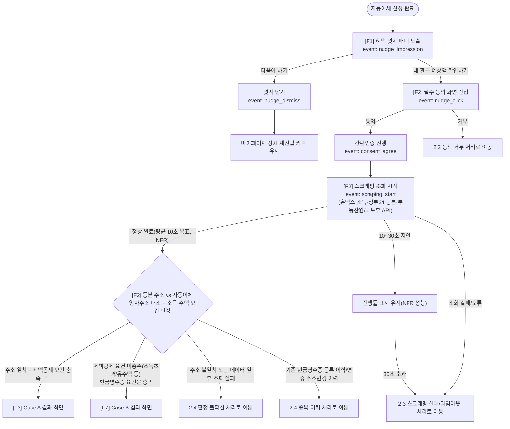
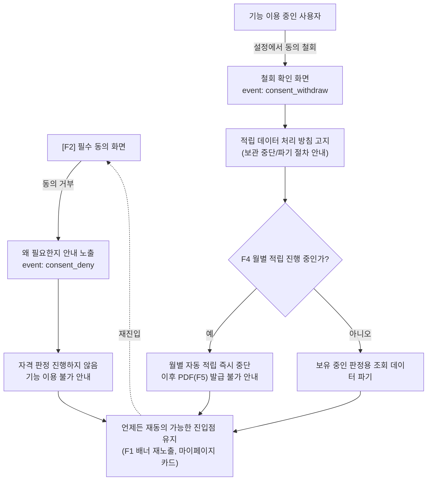
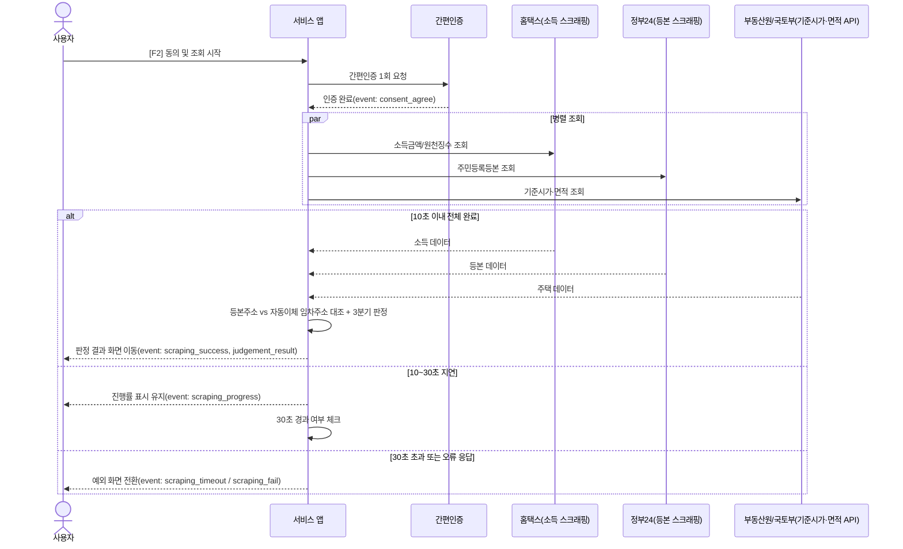
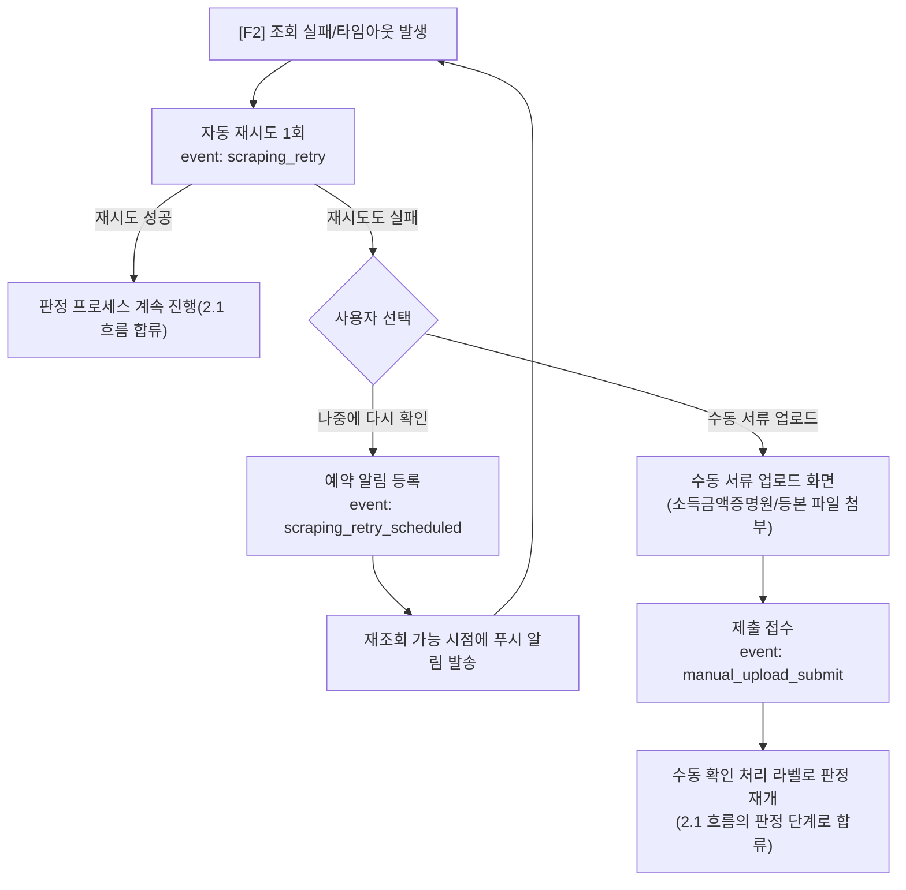
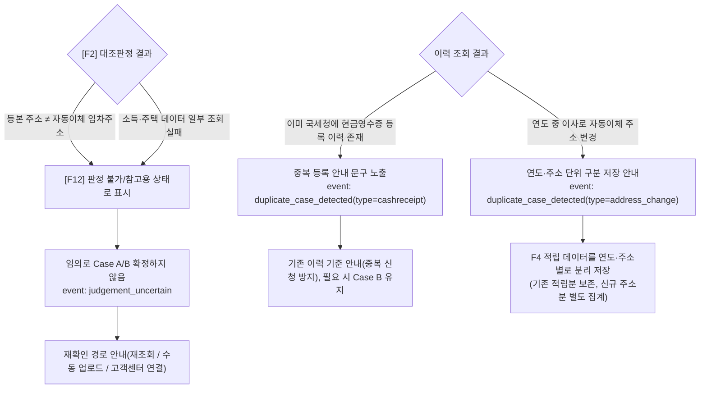
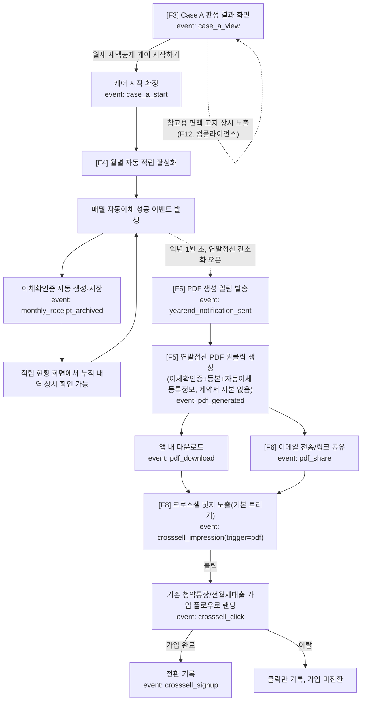
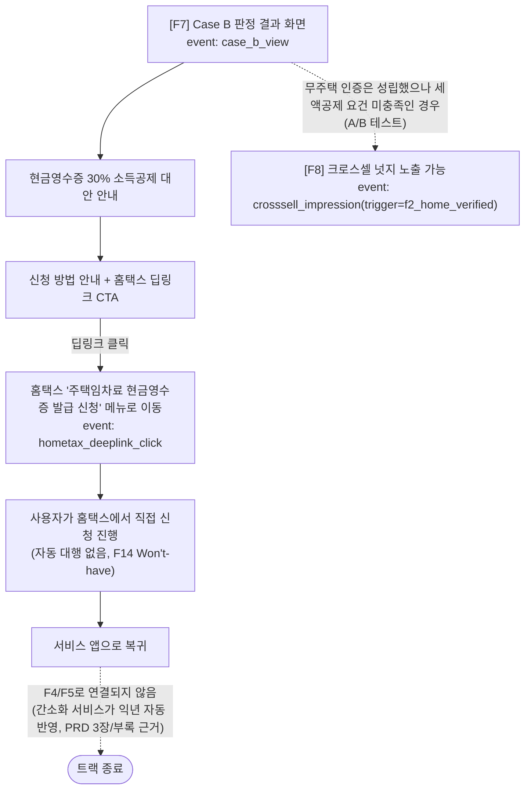
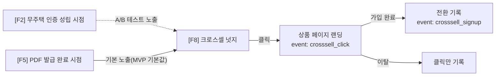

# UX 플로우: 월세 자동이체 연계 '원스탑 월세 세제혜택 케어' (MVP)

> **근거 문서**: `docs/planning/prd.md`(확정 MVP 범위, F1~F12 Must/Should, F13~F18 Won't-have), `docs/planning/rent-tax-benefit-concept.md`(원 컨셉 5단계 초안). 본 문서는 PRD 원문을 기준으로 하며, 컨셉 문서와 PRD가 상충하는 경우 **PRD가 우선**합니다.
>
> **범위 조정 반영 사항** (컨셉 문서 대비):
> - 컨셉 Step3 "계약서 OCR 등록/파싱"은 MVP에서 제외(F13, Won't-have). 대신 **자동이체 등록 정보(임차 주소·임대인 정보)와 등본 스크래핑 주소를 대조**하는 것만으로 1차 판정한다(PRD 3장 F2, MVP 판단 근거).
> - 컨셉 Step4 Case B "국세청 현금영수증 자동 신청 대행"은 MVP에서 제외(F14, Won't-have). 대신 **안내 + 홈택스 딥링크로 유도**하며, 실제 신청은 사용자가 직접 수행한다(PRD F7).
> - 계측(F9)은 화면 기능이 아니지만 MVP 존재 목적이 "가설 검증"이므로 최우선 Must이며, 아래 모든 플로우에 이벤트 시점을 명시한다.
> - PRD 4장 비기능 요구사항에 정의된 예외 케이스(스크래핑 실패/타임아웃, 필수 동의 거부/철회, 판정 불확실/데이터 불일치, 중복 이력)를 플로우의 명시적 분기로 표현한다.
> - 컨셉 문서의 Step3, Step4 Case B 자동화, Step5의 "계약서 사본" 첨부, 전입신고 변경 알림(F15), 경정청구 예약(F16), 청약가점 락인 대시보드(F17), 광고/제휴 리베이트(F18)는 이번 플로우에 **포함하지 않는다**(PRD Won't-have).

---

## 0. MVP 화면 범위 한눈에 보기

| 컨셉 문서 Step | MVP 반영 여부 | 비고 |
| --- | --- | --- |
| Step1 (트리거 넛지) | 반영 (F1) | 문구 동일 유지 가능 |
| Step2 (원클릭 자격 조회) | 반영 (F2), 단 대조 항목 축소 | 계약서 대조 제거, 자동이체 등록정보 대조로 대체 |
| Step3 (계약서 OCR) | **제외** (F13, Won't-have) | 등본 주소 vs 자동이체 등록 임차주소 대조로 1차 판정 완결 |
| Step4 Case A (세액공제 케어 시작) | 반영 (F3) | 동일 |
| Step4 Case B (현금영수증 자동 신청 대행) | **자동 대행만 제외** (F14, Won't-have) | 안내 + 홈택스 딥링크(F7)로 대체 |
| Step5 (연말정산 PDF, 단 계약서 사본 제외) | 반영 (F5·F6), 첨부물에서 계약서 사본 제외 | 이체확인증 + 등본 + 자동이체 등록정보로 구성 |
| (신규) 크로스셀 넛지 | 반영 (F8) | 컨셉 4장 로드맵 제언을 MVP 계측 대상으로 축소 도입 |
| (신규) 예외처리 전 구간 | 반영 (F10·F11·F12) | 컨셉 문서에 없던 MVP 신규 요구사항 |
| (신규) 계측 인프라 | 반영 (F9) | 컨셉 문서에 없던 MVP 신규 요구사항, 전 화면 선행 전제 |

---

## 1. 유저 저니맵

| 단계 | 사용자 상태 | 감정 | 니즈 | 터치포인트 | 계측 이벤트(F9) | PRD 근거 |
| --- | --- | --- | --- | --- | --- | --- |
| **인지** | 월세 자동이체 신청을 막 완료함 | 안도(이체 설정 완료) + 무관심(세제혜택은 낯섦) | "번거로운 절차 없이 나에게 이득이 되는지 바로 알고 싶다" | 자동이체 완료 화면 내 배너(F1) | `nudge_impression` | U1, F1 |
| **가입/진입** | 넛지를 클릭했으나 개인정보 제공(간편인증)에 망설임 | 호기심 + 개인정보 제공 불안 | "동의가 안전한지, 집주인에게 알려지진 않는지 확인받고 싶다" | 필수 동의 화면, "집주인 동의 불필요" 안내 | `nudge_click`, `consent_view`, `consent_agree`/`consent_deny` | U4, F2, F11 |
| **핵심 가치 경험 (조회~판정)** | 조회 진행 중 대기, 결과 확인 | 기대(환급액 확인) 또는 실망(대상 아님) | "내가 어느 트랙인지 명확히, 근거와 함께 알고 싶다" | 스크래핑 진행 화면, Case A/B 결과 화면 | `scraping_start/success/fail/timeout`, `judgement_result` | U1, U5, F2, F3, F7, F10, F12 |
| **핵심 가치 경험 (적립~발급)** | 매달 자동으로 증빙이 쌓이는 것을 인지, 연말정산 시즌에 PDF 수령 | 안심(귀찮은 일을 대신 해줌) → 만족(원클릭 발급) | "서류를 따로 안 챙겨도 되고, 연말정산 때 바로 제출하고 싶다" | 적립 현황 화면, PDF 발급 화면, 공유 시트 | `monthly_receipt_archived`, `pdf_generated`, `pdf_download`, `pdf_share` | U2, U3, F4, F5, F6 |
| **재방문/전환** | PDF 발급 직후 관련 상품 추천을 접함, 다음 해에도 서비스 재사용 | 신뢰(작년에도 잘 됐음) 또는 호기심(추가 혜택) | "이왕이면 관련된 다른 혜택도 부담 없이 알고 싶다" | 크로스셀 넛지 배너, 익년 1월 재알림 | `crosssell_impression`, `crosssell_click`, `crosssell_signup`, `autotransfer_retained`(계좌 유지 이벤트) | U6, U7, F8, North Star |
| **(전 구간) 이탈/예외** | 조회 실패, 동의 철회, 판정 불확실, 중복 이력 등 | 좌절, 신뢰 저하 우려 | "포기하지 않고 대체 경로로 계속 진행하고 싶다" | 재시도/수동업로드 화면, 철회 안내, 불확실 안내 | `scraping_retry`, `consent_withdraw`, `judgement_uncertain`, `duplicate_case_detected` | U8, F10, F11, F12, NFR |

---

## 2. 핵심 플로우

### 2.1 진입 및 자격 판정 (F1 → F2, 예외 분기 포함)

**분기 근거**
- 조회 완료 후 판정 갈래(Case A / Case B / 불확실 / 중복)는 PRD F2 설명과 `기능 간 의존관계 요약`("F2가 실패/거부되면 F10·F11로 빠진다")을 그대로 반영한 것이다.
- 계약서 OCR 없이 "등본 주소 vs 자동이체 등록 임차주소" 대조만으로 1차 판정하는 것은 PRD 3장 "MVP 판단 근거"의 명시적 결정이다(F13 제외 사유).

### 2.2 필수 동의 거부/철회 (F11)

**분기 근거**: PRD 4장 "예외처리 — 필수 동의 미동의/철회" 요구사항을 그대로 반영. 거부 시 판정을 진행하지 않고, 철회 시 기존 적립 데이터의 보관/파기 방침을 반드시 고지하도록 명시되어 있다.

### 2.3 스크래핑 실패/타임아웃 (F10, NFR 성능 연계)

**분기 근거**: PRD 4장 "예외처리 — 스크래핑 실패"에 명시된 "(1) 자동 재시도 1회, (2) 재시도 실패 시 예약 알림, (3) 장기 실패 시 수동 서류 업로드 대체 경로"를 순서대로 반영. NFR 성능 항목("10초 초과 시 진행률 노출, 30초 초과 시 F10 자동 전환")도 시퀀스 다이어그램에 반영했다.

### 2.4 판정 불확실/데이터 불일치 및 중복·이력 처리 (F12, NFR)

**분기 근거**: PRD 4장 "예외처리 — 판정 불확실/데이터 불일치"("임의 확정하지 않는다")와 "예외처리 — 중복/이력 처리"("연도·주소 단위로 구분 저장")를 그대로 반영. 이 두 케이스는 컨셉 문서 원안에는 없던 MVP 신규 요구사항이다.

### 2.5 Case A 세액공제 트랙 (F3 → F4 → F5 → F6 → F8)

**분기 근거**: PRD "기능 간 의존관계 요약" — "F3 → F4 → F5 → F8은 세액공제 트랙의 단일 선형 흐름"을 그대로 구현. PDF 첨부물에서 계약서 사본을 제외한 것은 F13(OCR/계약서) 미도입 결정에 따른 자연스러운 축소다.

### 2.6 Case B 현금영수증 안내 트랙 (F7, 자동 대행 없음)

**분기 근거**: PRD F7 설명 "자동 대행 아님, 사용자가 직접 신청"과 "기능 간 의존관계 요약"의 "F7은 F4/F5로 이어지지 않는다(현금영수증 트랙은 간소화 서비스가 익년 자동 반영)"를 그대로 반영. 원 컨셉 Step4 Case B의 "국세청 전산 자동 등록" 문구는 채택하지 않는다.

### 2.7 크로스셀 넛지 두 접점 요약 (F8)

**분기 근거**: PRD "기능 간 의존관계 요약" — "F8은 F2·F5 두 지점에서 노출 가능하되, MVP는 이탈 최소화를 위해 F5 시점을 기본으로 하고 F2 시점은 A/B 테스트 대상"을 그대로 반영.

---

## 3. 화면별 핵심 요소

| 화면 ID | 화면명 | 목적 | 필수 정보/액션 구성요소 | 관련 기능 | 계측 이벤트 |
| --- | --- | --- | --- | --- | --- |
| S1 | 트리거 넛지 배너 | 자동이체 완료 직후 이탈 방지, 진입 유도 | 예상 절세액 요약 문구, "집주인 동의 불필요" 안내, CTA(내 환급 예상액 확인하기), 보류 액션(다음에 하기) | F1 | `nudge_impression`, `nudge_click`, `nudge_dismiss` |
| S2 | 필수 동의 화면 | 간편인증 기반 마이데이터 조회 동의 수집 | 조회 항목 목록(홈택스 소득, 정부24 등본), 목적 외 미사용 안내, 동의/거부 액션, 개인정보 처리방침 링크 | F2, F11 | `consent_view`, `consent_agree`, `consent_deny` |
| S3 | 스크래핑 진행 화면 | 조회 진행 상태를 실시간 인지시켜 이탈 방지 | 항목별 진행 체크리스트(소득/등본/주소매칭), 진행률 표시(10초 초과 시), 취소 불가/백그라운드 안내 | F2 | `scraping_start`, `scraping_progress`, `scraping_success`, `scraping_fail`, `scraping_timeout` |
| S4 | 판정 결과 — Case A | 세액공제 대상자에게 결과 제시 및 케어 시작 유도 | 예상 환급액(금액/계산 근거), "월세 세액공제 케어 시작하기" CTA, 참고용 면책 문구(F12) 상시 노출 | F3, F12 | `case_a_view`, `case_a_start` |
| S5 | 판정 결과 — Case B | 세액공제 불가 대상자에게 대안 안내 | 30% 소득공제 설명, 신청 방법 안내, 홈택스 딥링크 CTA, "자동 대행 아님" 명시 문구, 참고용 면책 문구(F12) | F7, F12 | `case_b_view`, `hometax_deeplink_click` |
| S6 | 판정 불확실/데이터 불일치 안내 | 임의 확정 방지, 재확인 경로 제시 | 불일치/미조회 항목 표시, "참고용 판정 불가" 상태 배지, 재조회/수동 업로드/CS 연결 액션 | F12, NFR | `judgement_uncertain` |
| S7 | 스크래핑 실패/재시도 화면 | 실패 시에도 이탈 없이 대체 경로 제공 | 실패 사유 요약, 자동 재시도 상태, "나중에 다시 확인" 예약 액션, 수동 업로드 진입 액션 | F10 | `scraping_retry`, `scraping_retry_scheduled` |
| S8 | 수동 서류 업로드 화면 | 장기 실패 시 서류 첨부로 대체 진행 | 소득금액증명원/등본 파일 첨부 UI, 업로드 가이드, 제출 후 처리 예상 시간 안내 | F10 | `manual_upload_submit` |
| S9 | 동의 거부/철회 안내 화면 | 거부/철회 시에도 재진입 경로 유지 | 왜 필요한지 설명, 이용 불가 범위 안내, 재동의 진입 버튼, (철회 시) 데이터 보관/파기 방침 고지 | F11, NFR | `consent_deny`, `consent_withdraw` |
| S10 | 중복·이력 안내 화면 | 중복 신청/이력 혼선 방지 | 기존 이력 요약(현금영수증 등록 여부, 주소 변경 이력), 연도·주소별 분리 저장 안내 | NFR(중복/이력) | `duplicate_case_detected` |
| S11 | 월별 적립 현황 화면 | 자동 적립 상태를 사용자가 확인·신뢰하도록 함 | 월별 이체확인증 리스트(생성일·상태), 누적 개월 수, 다음 PDF 발급 예정 안내 | F4 | `monthly_receipt_archived`(생성 시점), 화면 조회 시 `receipt_history_view` |
| S12 | 연말정산 PDF 발급 화면 | 1년 치 증빙을 원클릭 패키지로 제공 | 연간 총 납부액/예상 공제액 요약, 첨부 서류 목록(이체확인증 N건, 등본, 자동이체 등록정보), 다운로드/공유 액션 | F5, F6 | `pdf_generated`, `pdf_download` |
| S13 | PDF 공유 시트 | 회사 제출 등 외부 전달 지원 | 이메일 전송 입력, 링크 공유 옵션, 전송 완료 확인 | F6 | `pdf_share` |
| S14 | 크로스셀 넛지(배너/카드) | 관련 상품 추천 및 전환 계측 | 추천 상품명(청약통장/전월세대출), 추천 사유 한 줄, CTA(자세히 보기), 트리거 위치 태그(F2/F5) | F8 | `crosssell_impression`, `crosssell_click`, `crosssell_signup` |
| S15 | 마이페이지 재진입 카드 | 배너를 닫거나 동의를 거부한 사용자를 위한 상시 진입점 | 현재 진행 상태 요약(미시작/조회 대기/케어 진행중), 재진입 CTA | F1, F11 | `reentry_card_view`, `reentry_click` |

---

## 4. 엣지케이스 & 예외 흐름 정리

| 케이스 | 트리거 조건 | 처리 방식 | 화면 | PRD 근거 |
| --- | --- | --- | --- | --- |
| 스크래핑 실패/오류 | 정부24/홈택스 접속 불가, 야간 점검, 성수기(5월 종소세 신고기간 등) 부하 제한 | 자동 재시도 1회 → 실패 시 예약 알림 또는 수동 서류 업로드 대체 | S7, S8 | PRD 4장 "예외처리 — 스크래핑 실패" |
| 조회 지연/타임아웃 | 10초 초과 시 진행률 노출, 30초 초과 시 자동 전환 | 진행률 표시 유지 → 30초 초과 시 F10 경로로 전환 | S3 → S7 | PRD 4장 "성능" NFR |
| 필수 동의 거부 | 간편인증 동의 화면에서 거부 선택 | 판정 미진행, 필요성 안내, 재동의 진입점 상시 유지 | S9 | PRD 4장 "예외처리 — 필수 동의 미동의/철회" |
| 동의 철회 | 이용 중 설정에서 동의 철회 | 데이터 보관/파기 방침 고지, F4 적립 중단, PDF 발급 불가 안내 | S9 | 상동 |
| 판정 불확실/데이터 불일치 | 등본 주소 ≠ 자동이체 임차주소, 또는 소득/주택 데이터 일부 미조회 | "판정 불가/참고용" 표시, 임의 확정하지 않음, 재확인 경로 제공 | S6 | PRD 4장 "예외처리 — 판정 불확실/데이터 불일치" |
| 중복 이력 — 기존 현금영수증 등록자 | 국세청에 이미 현금영수증이 등록되어 있음 | 별도 안내 문구로 중복 신청 방지 | S10 | PRD 4장 "예외처리 — 중복/이력 처리" |
| 중복 이력 — 연중 주소 변경 | 연도 중 이사로 자동이체 등록 주소가 변경됨 | F4 적립 데이터를 연도·주소 단위로 구분 저장, 기존 적립분 보존 | S10, S11 | 상동 |
| 계약서 OCR 관련 예외 | 해당 없음(MVP는 OCR 미사용) | 이번 범위 제외, Phase 2 도입 시 재촬영 유도/수동 입력 폴백을 선반영 설계 | — | PRD 4장 "예외처리 — OCR 인식 실패"(F13 Won't-have) |
| 참고용 면책/최종 확인 미비 | 자동 판정 결과를 최종 확정처럼 오인 | 모든 판정 결과·딥링크 진입 전 "참고용" 면책 문구 상시 노출, 실제 신청은 사용자 최종 확인 필수 | S4, S5, S6 | F12, PRD 4장 "컴플라이언스" |

---

## 5. 계측 이벤트 설계 (F9)

> F9는 F1 출시 이전에 선행 구축되어야 하며, 이후 모든 기능은 아래 이벤트를 발생시켜야 한다(PRD "기능 간 의존관계 요약").

| 이벤트명 | 발생 시점(화면) | 주요 속성(예시) | 용도 |
| --- | --- | --- | --- |
| `nudge_impression` | S1 노출 시 | user_id, autotransfer_id, 노출 시각 | 넛지 도달률 측정, 미이용 대조군 태깅 시작점 |
| `nudge_click` / `nudge_dismiss` | S1 액션 시 | click 여부 | 기능 완주율(F1 대비 F5) 산정의 분모 |
| `consent_view` / `consent_agree` / `consent_deny` | S2 | 동의 항목, 결과 | F2 진입~동의 전환율, F11 예외 비율 |
| `consent_withdraw` | S9(철회) | 철회 시점, 기존 적립 개월 수 | 이탈 코호트 분석, 데이터 파기 이행 확인 |
| `scraping_start` / `scraping_progress` / `scraping_success` / `scraping_fail` / `scraping_timeout` | S3 | 소요 시간, 실패 사유 코드 | 스크래핑 성공률/오류율(보조 지표), 원가 베이스라인 |
| `scraping_retry` / `scraping_retry_scheduled` | S7 | 재시도 횟수 | F10 예외 처리 비율 |
| `manual_upload_submit` | S8 | 첨부 서류 종류 | 수동 대체 경로 이용률 |
| `judgement_result` | S4/S5 진입 시 | case=A/B, 판정 근거 요약 | Case A/B 분기 비율(보조 지표), 타겟 세그먼트 재검증 |
| `judgement_uncertain` | S6 | 불일치 사유 | 판정 불확실/예외 처리 비율(보조 지표) |
| `duplicate_case_detected` | S10 | type=cashreceipt/address_change | 데이터 파이프라인 안정성, CS 부담 예측 |
| `case_a_view` / `case_a_start` | S4 | — | Case A 트랙 진입·전환율 |
| `monthly_receipt_archived` | S11(백그라운드 생성) | 이체 회차, 연도·주소 태그 | F4 자동 적립 정상 동작 확인, North Star 코호트 유지 확인 |
| `yearend_notification_sent` / `pdf_generated` / `pdf_download` | S12 | 연간 누적 개월 수 | 기능 완주율(F1 대비 F5), North Star 코호트("F3 완주" 정의 확정 근거) |
| `pdf_share` | S13 | 채널(이메일/링크) | Should 기능 이용률 |
| `case_b_view` / `hometax_deeplink_click` | S5 | — | Case B 수요 검증(F14 재검토 조건 판단 근거) |
| `crosssell_impression` | S14 | trigger=f2_home_verified/pdf | 크로스셀 상위 퍼널(보조 지표) |
| `crosssell_click` / `crosssell_signup` | S14 → 기존 가입 플로우 | 상품 종류(청약통장/전월세대출) | 크로스셀 클릭·가입 전환율(보조 지표) |
| `reentry_card_view` / `reentry_click` | S15 | — | 이탈 후 재진입 전환 측정 |
| `autotransfer_retained` / `autotransfer_canceled`(기존 자동이체 시스템 연동 이벤트) | 서비스 외부(자동이체 상품 시스템) | 이용군/미이용군 태그, 유지 개월 수 | **North Star**: 이용 코호트(F3 완주) vs 대조군(F1 미클릭/F2만 하고 이탈)의 계좌 해지율 비교 |

**코호트 태깅 원칙**: 모든 이벤트에 `cohort=used_service`(F3 완주 기준) 또는 `cohort=control`(F1 미노출/미클릭 또는 F2 조회만 하고 이탈)을 부여해, PRD 6장 North Star Metric 및 3개월/6개월/12개월 유지율 비교가 가능하도록 한다.

---

## 6. 설계 결정과 PRD 근거 매핑 요약

| 화면/분기 결정 | 내용 | PRD 근거 |
| --- | --- | --- |
| 계약서 업로드 화면 없음 | 등본 주소 vs 자동이체 등록 임차주소 대조만으로 1차 판정 | PRD 3장 F13 제외 사유, F2 설명 |
| Case B에 "원클릭 신청" 버튼 없음, 딥링크 CTA로 대체 | 세무대리 유사행위 규제 리스크 회피 | PRD 3장 F14 제외 사유, F7 설명, 7장 "세무대리 유사행위 규제" |
| Case B → F4/F5로 연결되지 않음 | 현금영수증 트랙은 국세청 간소화 서비스가 익년 자동 반영 | PRD "기능 간 의존관계 요약" |
| PDF 첨부물에 계약서 사본 없음 | OCR 미도입에 따라 첨부 구성이 이체확인증+등본+자동이체 등록정보로 축소 | PRD F5 설명, F13 Won't-have |
| 모든 판정 결과 화면에 면책 문구 상시 노출 | 오판정에 따른 금융소비자보호 이슈 완화 | PRD F12, 7장 "오판정에 따른 금융소비자보호 이슈" |
| 크로스셀 넛지는 F5 시점 기본, F2 시점은 A/B 테스트 | 이탈 최소화 우선, 크로스셀 재무 기여가 낮다는 사업성 검토 결론 반영 | PRD "기능 간 의존관계 요약", 7장 "크로스셀 재무 기여 한계" |
| 전 화면에 계측 이벤트 명시 | F9가 F1 출시 전 선행 구축 대상이며 모든 기능이 이벤트를 발생시켜야 함 | PRD F9, "기능 간 의존관계 요약" |
| 스크래핑 실패 시 3단계 대체 경로(재시도→예약→수동업로드) | NFR "예외처리 — 스크래핑 실패" 요구사항 순서 그대로 반영 | PRD 4장 |
| 동의 철회 시 적립 중단 + 파기 고지 | NFR "예외처리 — 필수 동의 미동의/철회" | PRD 4장 |
| 판정 불확실 시 임의 확정 금지 | NFR "예외처리 — 판정 불확실/데이터 불일치" | PRD 4장 |
| 중복 이력은 연도·주소 단위로 분리 저장 | NFR "예외처리 — 중복/이력 처리" | PRD 4장 |

---

## 참고 문서
- `docs/planning/prd.md` — 확정 MVP 범위(F1~F12 Must/Should, F13~F18 Won't-have), 비기능 요구사항, 성공 지표
- `docs/planning/rent-tax-benefit-concept.md` — 원 서비스 컨셉 및 5단계 UX 플로우 초안(본 문서 대비 축소 반영)
